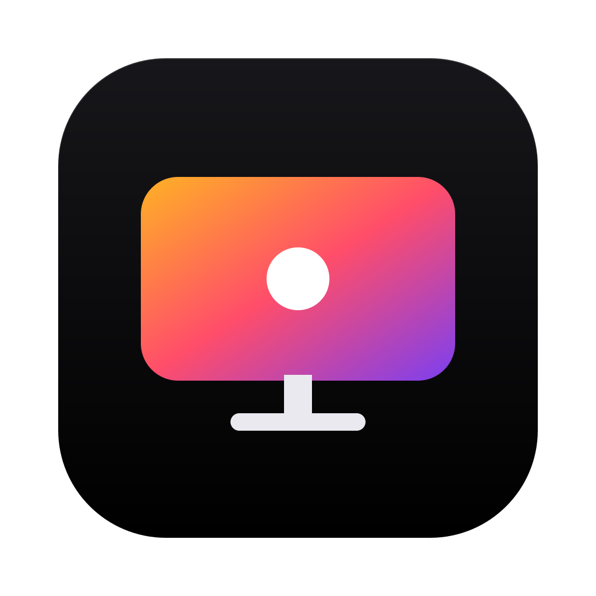

<p align="center">
  
</p>

<h1 align="center">TelaViva OLED</h1>

<p align="center">
  Control the brightness and volume of your external monitors from the menu bar or system tray,<br>
  and protect OLED panels by dimming them when nobody is in front of the screen.
</p>

<p align="center">
  <a href="https://github.com/ksfreitas/telaviva-oled/actions/workflows/macos.yml"></a>
  <a href="https://github.com/ksfreitas/telaviva-oled/actions/workflows/windows.yml"></a>
  <a href="LICENSE"></a>
  
</p>

## Highlights

- **Every external monitor in one place.** A brightness slider and a volume slider per monitor, sent over DDC/CI. Controls a monitor does not support are shown as unavailable instead of failing silently.
- **Presence protection (optional).** Local face detection dims a monitor when you step away and restores it when you come back. It detects any face: it never identifies anyone and needs no enrollment. Poor lighting pauses detection instead of being mistaken for absence.
- **Screensaver protection (optional).** Dim each monitor to a brightness you choose while the screensaver runs.
- **Keep awake while present (optional).** Keep presence monitoring active independently of brightness protection and request that automatic screensaver, locking and sleep wait while a face is detected. On macOS this uses system activity requests; on Windows it holds a system and display request and sends one zero-displacement mouse move per second. The first no-face result or unavailable detection releases those requests. Manual lock and sleep take precedence; [OS acceptance is tracked separately](specs/archived/keep-awake-with-presence/validation.md), and physical Windows acceptance is still pending.
- **Battery aware.** Brightness protection pauses on battery by default. With Keep awake while present enabled, on macOS or Windows, the camera's battery and brightness gates are overridden while it is enabled.
- **Follow your laptop (optional).** On a MacBook or a Windows laptop, external monitors can follow the built-in panel's brightness, including its automatic brightness, through calibration points you manage.
- **Protect the laptop screen.** The built-in screen of a MacBook or a Windows laptop dims like an external monitor when you step away or the screensaver starts, and is restored afterwards. An optional setting turns off the system's automatic brightness while the screen is protected. A **Monitored display** choice (Automatic by default, remembered by priority like the camera) decides when the camera runs, and the built-in camera is ignored while the lid is closed.
- **Hardware keys (optional).** Volume, mute and (on macOS) brightness keys can drive the external monitor.
- **Selectable inference device.** Automatic uses a validated integrated GPU on Windows or validated CoreML on Apple Silicon, with CPU fallback on both platforms. Neural Engine and GPU selections on macOS are preferences; CoreML may run unsupported operations on the CPU.
- **Private by design.** Everything runs on your device, with no telemetry and no stored camera images. See [Privacy](#privacy).
- **English and Portuguese.** The interface is available in English (US) and Portuguese (Brazil).

## Platform support

| | macOS | Windows |
| --- | --- | --- |
| Requirements | Apple Silicon, macOS 14 or later | Windows 11 x64 |
| Interface | SwiftUI and AppKit, menu bar | WinUI 3, system tray with a flyout |
| Distribution | Zip from GitHub Releases, ad-hoc signed and not notarized, or built locally | Per-user zip with an installer script, unsigned |
| Not supported yet | Intel Macs | Windows 10, ARM64 |
| Laptop follow | MacBook | Laptop (called Notebook in Portuguese) |
| Built-in screen protection | MacBook | Laptop (called Notebook in Portuguese) |

Both apps are native shells over one shared Rust core, with face detection by the YuNet model through ONNX Runtime. The design is recorded in [`ARCHITECTURE.md`](ARCHITECTURE.md) and the [architecture decision records](adr/).

## Status

This checkout reports application version 0.1.4 and remains under active development. The CI badges above show workflow status; hardware validation is still partial on both platforms:

- DDC support depends on the monitor, the port, the cable, any adapter or dock, and the graphics hardware. It is not uniform, and a passing check on one setup says nothing about another.
- Only a small number of monitors and computers have been used for physical checks. Many checks are still pending, among them camera sharing with video calls, multi-monitor and dock setups, monitor sleep and wake, Laptop follow on real laptops, laptop screen protection and its automatic brightness option (the Windows laptop checks are not yet recorded), and keyboard routing on other keyboards.
- The Windows build is not code-signed, and the macOS app is ad-hoc signed and not notarized, so each system may warn the first time you open a downloaded copy.
- Setting brightness to zero does not guarantee that an OLED panel turns completely off, and it does not prevent all burn-in.

Recorded results, including what has not been checked, are in the validation reports: the [macOS release-readiness report](specs/archived/external-monitor-control-and-oled-presence-protection/validation/release-readiness.md), the [MacBook follow checklist](specs/archived/macbook-brightness-follow/validation/hardware-checklist.md) and the [Windows hardware checklist](specs/archived/windows-version/validation/hardware-checklist.md). Code that exists in the repository is not proof of hardware support.

## Install

### Windows

The Windows release is a per-user zip. Neither building nor installing needs administrator rights.

1. Get `TelaVivaOLED-<version>-win-x64.zip` from the [GitHub Releases](https://github.com/ksfreitas/telaviva-oled/releases) page, or build it yourself with `scripts\build-windows.ps1` (see [Build from source](#build-from-source)). Check the zip against its SHA-256.
2. Extract the zip and run:

   ```powershell
   powershell -NoProfile -ExecutionPolicy Bypass -File .\Install-TelaVivaOLED.ps1
   ```

3. Start TelaViva OLED from the Start menu. Windows 11 may hide a new tray icon in the overflow area: open Settings > Personalization > Taskbar > Other system tray icons and turn it on.

The app installs to `%LOCALAPPDATA%\Programs\TelaVivaOLED`. Because the build is unsigned, SmartScreen may show "Windows protected your PC" the first time: choose **More info**, then **Run anyway**, and only for a zip you downloaded from this project and checked. To uninstall, use Settings > Apps, or run `Uninstall-TelaVivaOLED.ps1` from the install folder; your settings stay in `%LOCALAPPDATA%\TelaVivaOLED` unless you pass `-RemoveUserData`. All options are in the [Windows packaging guide](packaging/windows/README.md).

### macOS

The macOS release is a zip of an ad-hoc signed app for Apple Silicon, macOS 14 or later.

1. Get `TelaVivaOLED-<version>-macos-arm64.zip` from the [GitHub Releases](https://github.com/ksfreitas/telaviva-oled/releases) page, or build the app yourself (see [Build from source](#build-from-source)). Check the zip against its SHA-256.
2. Extract the zip and move `TelaViva OLED.app` to your Applications folder.
3. Open it. The app is not notarized, so macOS blocks the first launch of a downloaded copy: open System Settings > Privacy & Security and choose **Open Anyway** for TelaViva OLED. Do this only for a zip you downloaded from this project and checked.

To run a local build instead:

```sh
open 'build/macos/TelaViva OLED.app'
```

Both the release and the local build are ad-hoc signed. Developer ID signing and notarization are not done yet. See the [macOS packaging guide](packaging/macos/README.md).

## Getting started

1. Open the app from the menu bar (macOS) or the tray icon (Windows). The icon shows presence: a filled dot when a face is detected, no dot when no face is detected or presence is off, suspended or unavailable, and a dot outline when light is insufficient.
2. Adjust brightness and volume for each detected external monitor. The popup fits one to three monitors and scrolls beyond that.
3. Open **Settings** to choose the language, the camera, the sampling intervals, battery behavior, launch at login and the keyboard steps.
4. Turn on **presence protection** and grant camera access. Two valid no-face checks dim the monitor, and a returning face restores it.
5. Optionally turn on **screensaver protection** and pick a **Protection brightness** for each monitor. Each monitor also has a switch that includes it in or excludes it from OLED protection.
6. Open **Settings > About** to see the version and whether a newer release exists. The app only informs you; it never downloads or installs an update.

The [user guide](docs/user-guide.md) covers presence timing, protection reasons, laptop screen protection and the monitored display, Laptop follow and calibration, keyboard routing, Windows specifics and limits.

## Privacy

- Everything runs locally and the app has no telemetry.
- Camera frames are processed in memory and are never stored, transmitted or logged. Device identifiers are not logged.
- Diagnostic logs show a monitor only as a short hashed id, never by its serial number, name or connection path.
- Presence means detecting any face. The app does not identify people or enroll faces.
- The only network request is an anonymous HTTPS GET to the GitHub releases API (`ksfreitas/telaviva-oled`) that looks for a newer version. It is made only when the About page is open or **Check now** is pressed, sends nothing but the app version in the `User-Agent` header, and downloads nothing.

## Build from source

### macOS

Requirements: Apple Silicon, macOS 14 or later, Xcode command-line tools and macOS SDK, stable Rust and Python 3. From the repository root:

```sh
./scripts/build-macos.sh
```

The script creates `build/macos/TelaViva OLED.app`. On the first build it downloads the pinned ONNX Runtime and verifies its checksums; the app itself never downloads runtime files. Run `./scripts/build-macos.sh --help` for usage.

### Windows

Requirements: Windows 11 x64, Windows PowerShell 5.1, stable Rust for `x86_64-pc-windows-msvc`, and Visual Studio 2022 with the Desktop development with C++ workload, the Roslyn compiler, the Windows 11 SDK 10.0.26100 and the Windows App SDK C++ component. From the repository root:

```powershell
powershell -NoProfile -ExecutionPolicy Bypass -File scripts\build-windows.ps1
```

The script fetches the pinned ONNX Runtime on the first run, builds the app, runs the native tests and writes `dist\TelaVivaOLED-<version>-win-x64.zip`, printing its SHA-256. Options and prerequisites are in the [Windows packaging guide](packaging/windows/README.md).

### Tests and checks

The shared Rust checks run on both platforms. The integration test that executes the pinned model needs the ONNX Runtime fetched by the build script, so CI skips it:

```sh
cargo fmt --all -- --check
cargo test --workspace --all-targets --locked -- --skip bundled_runtime_executes_pinned_yunet_model_on_cpu
cargo clippy --workspace --all-targets --locked -- -D warnings
```

After fetching the runtime, run `cargo test --workspace --all-targets --locked` to include it. The macOS shell has shell-script test suites under `tools/tests/` (`tools/tests/test-core-bridge.sh` needs `libtelaviva_core.a` built first); the Windows shell tests run as part of `scripts\build-windows.ps1`. CI does not perform camera acceptance or physical monitor writes.

## Repository layout

- `crates/telaviva-core/`: shared settings, protection policy and the C ABI.
- `crates/telaviva-inference/`: image-quality assessment and local YuNet inference.
- `native/macos/`: SwiftUI/AppKit shell and macOS device adapters.
- `native/windows/`: WinUI 3 shell, the Windows platform layer and tests.
- `include/`: C headers used by the native shells.
- `assets/`: face model and branding sources.
- `packaging/` and `scripts/`: build and packaging for each platform.
- `tools/`: test scripts, icon generation and the inference runtime fetcher.
- `licenses/`: third-party license notices and provenance.

## Documentation

- [User guide](docs/user-guide.md): how each feature behaves.
- [`ARCHITECTURE.md`](ARCHITECTURE.md) and [`api.md`](api.md): the design and the native C ABI.
- [`adr/`](adr/): architecture decision records.
- [`specs/`](specs/): archived requirements, plans and validation evidence.
- [`CHANGELOG.md`](CHANGELOG.md): release history.

## Contributing

Issues and pull requests are welcome. Before you start, read [`AGENTS.md`](AGENTS.md) and [`ARCHITECTURE.md`](ARCHITECTURE.md). A few rules to know up front:

- A change applies to macOS and Windows together, with equivalent behavior, English (US) and Portuguese (Brazil) strings and tests on each, unless the maintainer scopes it to one platform.
- Redistributed dependencies and assets must be open source. Any new network use needs an architecture decision record first.
- Documentation and commit messages are in English (US).

## License

TelaViva OLED is licensed under the [MIT License](LICENSE). Third-party dependency, model, runtime and DDC attribution records are in [`licenses/`](licenses/README.md); those notices remain separate from the project's license. The Windows build redistributes the Windows App SDK and WinUI 3 runtime under Microsoft Software License Terms; see [`licenses/windows/`](licenses/windows/README.md).
