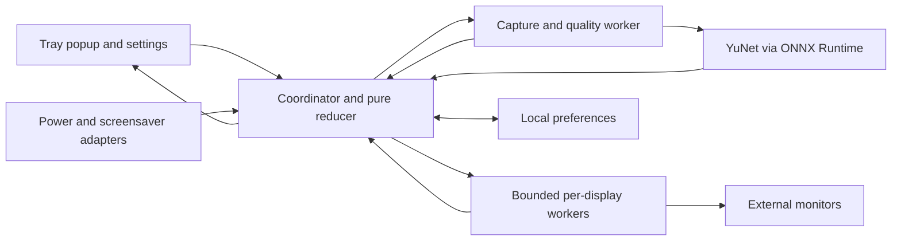

# Architecture: External Monitor Control and OLED Presence Protection

**Feature**: TelaViva OLED initial desktop application  
**Date**: 2026-10-15  
**Revised**: 2026-10-16 — native per-OS interfaces replace the initial egui proposal.  
**Branch**: `feat/oled-monitor-protection`  
**Specs**: [spec.md](spec.md) · [contracts.md](contracts.md)

## Summary

Build one Rust desktop application with an event-driven protection coordinator, a small tray/menu-bar interface, and independent platform adapters for monitor control, camera acquisition, and operating-system state. Face detection runs locally using a bundled lightweight model, with CPU fallback and acceleration enabled only for configurations where measurements demonstrate an energy benefit. Initial macOS support targets Apple Silicon; unsupported DDC connections, including affected M1 paths, are an accepted compatibility limitation rather than a reason to fake successful control.

This document distinguishes selected design from implementation evidence. Implementation is now in progress, focused on macOS by user request; Windows-native work is deferred. See validation/results.md and validation/coverage.md for checks actually performed. Acceptance targets below are not achieved benchmarks merely because they are specified.

## Technical Context

- **Language/Stack**: one repository and one modular desktop application per OS, with a shared Rust core crate built by Cargo as rlib/staticlib, a SwiftUI/AppKit shell built by Xcode on macOS, and a C++/WinRT WinUI 3 shell built by MSBuild on Windows. A root Cargo workspace organizes the core; this is not a service architecture or independently deployed product suite.
- **Key Dependencies**: `ort`/ONNX Runtime, optional OpenVINO, YuNet, `serde`/`serde_json`, `crossbeam-channel`, `fluent-bundle`/`unic-langid`, `directories`, `tracing`, platform-specific `windows`/`objc2` bindings, and the native platform UI facilities. egui/eframe and tray-icon are superseded and must not be added. Pin compatible versions and commit Cargo.lock during implementation; exact release numbers are not guessed here.
- **Storage**: versioned local JSON preferences in the platform configuration directory; bounded diagnostic log files; no images, video, biometric templates, or persisted brightness ownership.
- **Testing**: deterministic Rust policy tests with a fake clock and adapters, model input/output fixtures, native integration checks, GUI smoke checks, and measured hardware acceptance runs. Test images must be synthetic or explicitly licensed fixtures, never persisted frames from runtime webcam monitoring; license them in the asset manifest.
- **Platform**: initial build targets `aarch64-apple-darwin` and `x86_64-pc-windows-msvc`. Engineering baselines: macOS 14+ on Apple Silicon and Windows 11 24H2+ x64, subject to the actual minimum requirements of pinned dependencies. These are intended initial test targets, not verified compatibility claims. Intel Macs and Windows ARM64 are deferred.

## Technical Decisions

### Decision 1: Modular Rust application with a blocking event loop

**What**: Keep one process and one policy owner. The main thread owns native UI objects; a coordinator waits for bounded-channel events or the next deadline. Capture/inference uses one serial worker; DDC uses at most one worker per display, capped at eight active workers. Queue additional displays without spawning unbounded threads. Shutdown and battery events use a dedicated control path ahead of sampling.

**Why**: No continuous polling/render loop is needed for hidden windows, and policy races can be tested as ordered events. **Alternatives considered**: a service plus UI, an always-running async executor, and shared mutable state across callbacks. **Trade-offs**: native calls may stall and cannot be assumed cancellable; bounded workers and generation checks contain the impact, but cannot forcibly undo an OS operation already submitted.

### Decision 2: Native shells with one shared Rust core

**What**: On macOS, use AppKit NSStatusItem/NSPopover and SwiftUI controls hosted through NSHostingView; settings uses a native settings window. On Windows 11, use a C++/WinRT WinUI 3 shell, Win32 Shell_NotifyIcon, and an anchored WinUI popup window with standard sliders and settings controls. Follow native spacing, system light/dark themes, keyboard/focus/accessibility behavior and available OS materials; do not reproduce macOS controls using a Windows theme or the reverse. Hide windows at startup and show the popup on one left click. Escape/focus loss hides it, and closing settings does not quit. Shell visibility never controls the lifetime of the core. OS materials are optional decoration, not a dependency for usability or a requirement to match future OS versions exactly.

Both shells compile/link the same Rust static library through a versioned C ABI, render the same revisioned view model, and submit the same commands. Swift/C++ contains presentation and OS shell glue only: no duplicate battery, detection, DDC, or brightness-restoration policy. Native UI/main run loops own framework objects; the core owns coordinator state and worker lifetimes. Anchor to the tray/status-item rectangle, convert screen scale and clamp to work area; use the clicked screen if the shell cannot supply a rectangle. Slider groups are per monitor, unsupported controls show their reason, and the popup footer exposes Settings and Quit. Do not keep an app-driven redraw timer running while hidden.

**Why**: The user's per-OS appearance requirement supersedes the initial custom-drawn egui proposal. **Alternatives considered**: egui does not automatically supply native controls; Tauri would add a web interface; Slint's platform-looking styles are moving toward deprecation. **Trade-offs**: maintain two small presentation layers and two native toolchains, while sharing all application policy, localization and device logic. Native integration spikes must establish build, focus, event dispatch and static-library linkage on both systems. [Apple NSHostingView](https://developer.apple.com/documentation/swiftui/nshostingview), [Microsoft WinUI 3](https://learn.microsoft.com/en-us/windows/apps/winui), [Slint style direction](https://slint.dev/blog/default-native-style-change).

### Decision 3: Open-source dependency boundary

**What**: Bundle only open-source third-party libraries, inference runtime, and model artifacts. Proposed families are MIT/Apache-2.0 for Rust support crates, MIT for ONNX Runtime and the YuNet model folder, and MIT/Apache-2.0 for `ort`; verify the exact resolved graph and retain all applicable notices. Audit WinUI/Windows App SDK redistributed components as well as Cargo dependencies; do not assume the entire native package graph inherits one source repository's license. A release license/provenance manifest covers crates, NuGet/native binaries, model weights, fonts, icons, and adapted DDC code. Use `cargo-deny` with an explicit reviewed license allowlist in CI; an unknown/non-OSS third-party artifact fails packaging. The application is licensed under MIT (see the root `LICENSE`); third-party dependencies and assets retain their own licenses and notices.

Native macOS/Windows APIs, frameworks, SDKs and toolchains supplied by platform vendors are platform facilities, not represented as open source; Xcode/SwiftUI is required to build the native macOS UI. The open-source requirement applies to third-party libraries/assets introduced and redistributed by the app. No commercial DDC utility, cloud inference service, or paid toolkit add-on is required. **Alternatives considered**: proprietary third-party utilities and remotely hosted detection. **Trade-offs**: third-party code and model licenses must be checked separately from a repository's top-level license. [WinUI source](https://github.com/microsoft/microsoft-ui-xaml), [ONNX Runtime](https://github.com/microsoft/onnxruntime), [ort](https://github.com/pykeio/ort), [YuNet license](https://github.com/opencv/opencv_zoo/blob/main/models/face_detection_yunet/LICENSE).

### Decision 4: Platform-specific DDC with truthful capabilities

**What**: Windows uses the `windows` crate to enumerate logical/physical monitors and call Dxva2 VCP read/write functions. Map brightness to VCP `0x10`, speaker volume to `0x62`, and normalize from each reported maximum rather than assuming a raw maximum of 100. Read current brightness before applying automatic reductions; if it cannot be read, disable automatic protection for that display. Always destroy native monitor handles on disconnect/shutdown. Cache capability results for a connection generation and re-probe only on reconnect, explicit refresh, or a capability-changing failure.

Apple Silicon uses a small in-process C/Objective-C bridge compiled by `cc`, adapting the MIT-licensed transport/discovery approach of `m1ddc`, retaining attribution and a pinned upstream revision. Keep IOAVService-dependent declarations and unsafe calls inside that adapter; do not spawn an external CLI for each slider update. Enumerate CoreGraphics displays and bind them to I/O services using identity and connection data, not list order. This transport depends on undocumented macOS facilities and must fail closed if unavailable. Intel IOKit I2C support is out of scope.

**Why**: Windows exposes documented monitor APIs while Apple Silicon needs a different transport. **Alternatives considered**: assuming one cross-platform crate covers all Apple Silicon paths, shelling out repeatedly, and software dimming. **Trade-offs**: DDC depends on display, port, driver, dock, and adapter. M1 is not categorically excluded: compatible paths may work, while unsupported HDMI or other paths report Unsupported. No built-in-display controls or gamma/overlay fallback are included. [Windows VCP API](https://learn.microsoft.com/en-us/windows/win32/api/lowlevelmonitorconfigurationapi/nf-lowlevelmonitorconfigurationapi-getvcpfeatureandvcpfeaturereply), [m1ddc upstream](https://github.com/waydabber/m1ddc).

### Decision 5: Native camera capture with explicit sharing support

**What**: Windows uses MediaCapture/MediaFrameReader in shared read-only mode, video only, without changing the configuration owned by another app. Detect failure and guide the user to the OS multi-app setting when applicable; never toggle global camera settings silently. The recent multi-app setting is distinct from the older shared-read API and still needs testing with the actual camera/driver and another app. macOS uses AVFoundation through `objc2` bindings; avoid holding configuration locks and handle interruption/permission/reconnection events.

While present, acquire only the fresh sample needed for each default 10-second deadline and close the session between checks where startup/energy measurements justify it. While presence-dimmed, keep a bounded session delivering observations at the default one-second interval. Negotiate low capture resolution/frame rate only when configuration ownership permits; shared capture may retain another app's higher rate. Drop unused frames immediately, maintain one latest frame, and allow only one inference at a time. Disable/battery/shutdown cancels pending acquisition and invalidates in-flight results before they can change protection state.

**Why**: Sharing and camera lifecycle are platform behaviors, not properties guaranteed by a generic webcam wrapper. **Alternatives considered**: OpenCV VideoCapture or a generic cross-platform wrapper; neither is selected without proving shared access and energy behavior. **Trade-offs**: repeated camera starts may cost more energy and produce exposure warm-up/indicator changes. Select the measured strategy per supported adapter; never promise simultaneous capture on every device. [Windows sharing mode](https://learn.microsoft.com/en-us/uwp/api/windows.media.capture.mediacapturesharingmode?view=winrt-26100), [Windows multi-app setting](https://blogs.windows.com/windows-insider/2026/09/10/announcing-windows-11-release-preview-builds-26100-9539-26200-9539/), [Apple capture device sharing discussion](https://developer.apple.com/documentation/avfoundation/avcapturedevice/).

### Decision 6: YuNet and ONNX Runtime with measured acceleration

**What**: Bundle a pinned YuNet float32 ONNX model and use `ort` for inference; implement resizing, model-specific BGR channel layout, output decoding and non-maximum suppression in Rust, checked against upstream reference outputs. The original model's actual fixed input is 640×640: implementation inspection corrected the initial 320×320 assumption. Preserve the original verified weights and use 640×640 inputs rather than silently patching the model. Letterbox with coordinate mapping; a minimum acceptable face size must be established by fixtures. Start with confidence 0.8 and NMS IoU 0.3 as engineering parameters, then validate error rates before release. No OpenCV runtime is required merely to run the model. Model artifacts must pass license, checksum, shape, and output-parity checks before packaging.

CPU is the reliable baseline with one inference at a time, one intra-op thread, no busy spinning, and lazy session creation. Package ORT with CoreML support on macOS, using the OS-supplied CoreML framework with CPU fallback. On Windows, select Apache-2.0 OpenVINO for supported Intel integrated GPUs/NPUs behind the same detector interface, using its C API through a small Rust FFI wrapper; other GPUs retain ORT CPU detection initially. This deliberately avoids assuming that a source repository's open license covers a separately redistributed proprietary accelerator binary. Neither a downloadable DirectML runtime nor proprietary accelerator SDK is selected. Prefer ANE-capable CoreML configurations or validated integrated Intel devices; do not wake a discrete GPU automatically. Cache compiled model artifacts under a model/runtime/device hash, never frame data.

Acceleration is opt-in to the automatic selection table only after a representative device/model/driver profile demonstrates at least 10% lower incremental energy over the CPU pipeline with no acceptance regression. Unknown configurations use CPU until measured; startup or provider failure falls back visibly to CPU. Compare capture, preprocessing, transfers, runtime wakeups, and inference together, not inference time alone.

**Why**: A compact licensed model and detector boundary allow hardware acceleration without requiring it. **Alternatives considered**: OpenCV DNN adds a larger native dependency, BlazeFace introduces different export/model checks, GPU-only inference cannot satisfy fallback, and the legacy ORT OpenVINO integration is deprecated in favor of a newer plugin route. The direct OpenVINO C adapter avoids coupling this application to that provider transition. **Trade-offs**: Windows acceleration initially covers supported Intel devices rather than every vendor; sparse samples can favor CPU; low-light accuracy is unproven by generic face benchmarks. [YuNet model documentation](https://github.com/opencv/opencv_zoo/tree/main/models/face_detection_yunet), [CoreML provider](https://onnxruntime.ai/docs/execution-providers/CoreML-ExecutionProvider.html), [OpenVINO open-source runtime](https://github.com/openvinotoolkit/openvino), [OpenVINO integration transition](https://onnxruntime.ai/docs/execution-providers/OpenVINO-ExecutionProvider.html), [OpenVINO C API](https://docs.openvino.ai/2023.3/api/c_cpp_api/group__ov__core__c__api.html).

### Decision 7: Unknown illumination is not absence

**What**: Assess image usability before accepting a negative face result, accounting for exposure settling, luma distribution, blur, and the last in-memory face region when available. Initial quality thresholds are calibration parameters, not a universal lux estimate. Only an adequately lit, fresh, valid no-face observation counts toward two misses. Low light clears misses, removes the presence dimming reason, restores owned brightness if no independent reason remains, and stops face inference. Take light-only samples every 10 seconds and resume after two consecutive usable observations; apply hysteresis and reset misses on resumption.

After dimming, check image quality on the next return sample. If the monitor supplied the only usable face illumination, enter this suspension path rather than remaining stuck dark. Battery suspension, presence disabled, no eligible monitors, or shutdown takes precedence and closes the camera entirely. After repeated quality oscillation, remain suspended with a visible reason until lighting stabilizes; do not repeatedly dim and restore.

**Why**: Detection uncertainty must not become a false absence signal. **Alternatives considered**: every empty detection counts as absence, or continuous face inference in darkness. **Trade-offs**: brightness reduction is intentionally unavailable in insufficient light; automatic light recovery still uses occasional camera samples on AC. Quality thresholds and false-negative rates require real camera validation.

### Decision 8: One protection reducer and conservative brightness ownership

**What**: One coordinator owns per-monitor baselines, active reasons, override state, and generations. Effective brightness is `min(baseline, presence_target, screensaver_target)` for applicable reasons, so a reduction never increases a user's lower setting. Capture baseline once at episode start; never overwrite it with the app's reduced value. Removing a reason recomputes the target; only the removal of all reasons restores the baseline. Before restoration or a target change, read back ownership; if current brightness differs from the last app value, yield to the external/manual value and enter override. Same-value external writes cannot be detected and are an explicit DDC limitation.

Slider writes are coalesced with a 100-ms trailing update and an immediate final release value; do not repeatedly write identical values. App manual changes cancel automatic dimming for the current episode; it ends after underlying reasons clear. Re-evaluate from fresh state after resume/reconnect; never restore a previous process's baseline. On normal quit stop acquisition, invalidate events, and attempt owned restoration with a bounded shutdown deadline, reporting failures. Crashes cannot guarantee restoration; no stale disk journal is auto-applied on restart.

**Why**: Independent protections must not fight or destroy the value to restore. **Alternatives considered**: independent dimming loops and persisted ownership assumptions. **Trade-offs**: readback adds device traffic; no continuous external-change poll is needed because ownership is rechecked before actions and on opening controls. A native write already in flight may complete late; reconcile from fresh readback before any further action. [Contracts and state transitions](contracts.md).

### Decision 9: Power events, screensaver state, locale, and settings

**What**: Windows observes power messages and reads current power status; macOS uses IOPowerSources notifications and current-source snapshots. Unknown power state suspends presence when the battery option is enabled. Screensaver remains a separate reason: Windows queries `SPI_GETSCREENSAVERRUNNING` every two seconds only while that protection is enabled. Screen lock and display sleep are not treated as equivalent triggers.

On macOS isolate distributed `com.apple.screensaver.didstart`/`didstop` observation behind an experimental adapter. These names are not a documented public screensaver-state contract established by this research. Register before reading/reconciling initial state, detect already-running ScreenSaverEngine only as a hint, and keep initial state Unknown until the supported OS behavior is validated. Do not infer screensaver solely from inactivity, lock, or screen sleep. If reliable behavior cannot be established on a target release, show this protection as unavailable there; do not claim it works. A native spike is a release gate for this feature, not an architectural claim of a public API.

Use Fluent messages in `locales/en-US.ftl` and `locales/pt-BR.ftl`; locale auto follows supported OS language with en-US fallback, and manual choice persists. Format messages centrally, cover all tooltips/status/errors, preserve hardware names verbatim, and enforce key parity. Store schema-validated settings using atomic replacement and safe recovery; launch-at-login is opt-in using the OS facility, with signing/registration requirements checked in packaging. [Windows screensaver query](https://learn.microsoft.com/en-us/windows/win32/api/winuser/nf-winuser-systemparametersinfoa), [Windows power events](https://learn.microsoft.com/en-us/windows/win32/power/pbt-apmpowerstatuschange), [Apple power notifications](https://developer.apple.com/documentation/iokit/1523868-iopsnotificationcreaterunloopsou).

## Architecture Overview

Native shell callbacks and UI actions become typed commands. The coordinator applies pure state transitions, emits revisioned UI snapshots, schedules camera deadlines, and submits monitor work. Workers report observed results, never mutate application policy directly. Frames stay inside capture/quality/inference and are released immediately after use. There are no network services, user accounts, or telemetry.

### Component Structure

**New Files/Modules (planned, not generated):**

| Path | Purpose |
|---|---|
| `Cargo.toml`, `Cargo.lock` | Cargo workspace and reproducible Rust dependency graph |
| `crates/telaviva-core/{Cargo.toml,build.rs,src/lib.rs}` | Shared rlib/staticlib, target-specific native integration |
| `crates/telaviva-core/src/core/{state,events,reducer,scheduler}.rs` | Protection state, generations, priorities, deadlines |
| `crates/telaviva-core/src/monitor/{mod,identity,queue}.rs` | Display capabilities, stable binding, raw/normalized controls |
| `crates/telaviva-core/src/presence/{capture,quality,detector,provider}.rs` | Capture policy, frame quality, inference and fallback |
| `crates/telaviva-core/src/platform/windows/{camera,ddc,power,screensaver}.rs` | WinRT/Win32 adapters with explicit handle/thread ownership |
| `crates/telaviva-core/src/platform/macos/{camera,ddc,power,screensaver}.rs` | Apple Silicon adapters with native run-loop dispatch |
| `crates/telaviva-core/src/{ffi,runtime,ports,commands}/` | ABI entrypoints, bounded execution, adapter interfaces, validated commands |
| `include/telaviva_core.h` | Versioned C ABI, opaque handles, buffer ownership |
| `native/macos/{ddc_bridge.h,ddc_bridge.m}` | Isolated, attributed IOAVService transport bridge |
| `native/macos/TelaViva/{App,MenuBarController,MonitorPopup,SettingsView,CoreBridge}.swift` | Native macOS shell, popup, settings and Rust bridge |
| `native/macos/TelaViva.xcodeproj/` | Swift/AppKit build linking the arm64 Rust library |
| `native/windows/TelaViva/{App.xaml,App.xaml.cpp,TrayIcon.cpp,MonitorPopup.xaml,SettingsWindow.xaml,CoreBridge.cpp}` | Native WinUI shell, popup, settings and Rust bridge |
| `native/windows/TelaViva/TelaViva.vcxproj` | C++/WinRT build linking x64 Rust library |
| `crates/telaviva-core/src/i18n.rs`, `crates/telaviva-core/src/config/{schema,store}.rs` | Central translated strings, validated preferences/migrations |
| `locales/{en-US,pt-BR}.ftl`, `assets/` | Shared translations, licensed fonts/icons, model manifest/weights |
| `crates/telaviva-core/tests/`, `native/{macos,windows}/tests/` | Policy, adapter, ABI and native shell verification |
| `packaging/`, `.github/workflows/`, `deny.toml`, `licenses/` | Per-OS bundles/builds, license policy and artifact notices |

**Modified Files:** root `ARCHITECTURE.md` and `AGENTS.md` link the selected design while retaining planned status; `spec.md` records scope updates and closes low-light recovery at design level. No existing application code can be reused because none exists. `.idea/` is unrelated user/tool state and remains untouched.

### Component Relationships

### Data Flow

1. Startup loads validated settings, creates tray shell, discovers capabilities, and resolves power. Presence disabled/battery policy prevents camera startup.
2. A presence deadline requests a fresh image; quality failure returns Unknown/InsufficientLight. Valid detection produces Present or Absent; only two valid misses create a presence reason.
3. The coordinator captures each eligible display's baseline, checks identity, and writes its computed reduction. Observed completion updates status; queued stale requests are discarded.
4. A face return removes presence reasons; DDC readback protects manual changes before restoring or recomputing for screensaver. Settings changes reschedule without a burst of missed ticks.
5. Battery/disabled/shutdown cancels camera work before processing further observations. Screensaver effects remain independent and restoration respects ownership.

## Implementation Approach

### User Story Mapping

| Story | Components and dependencies | Validation |
|---|---|---|
| US-001 manual controls | monitor adapters, queue, popup | Two monitors, independent capabilities, raw-range conversion, failures |
| US-002 absence/restoration | reducer, scheduler, capture, DDC | Fake-clock misses/return, overlap, ownership, stale generations |
| US-003 configurable presence | settings, capture, quality, detector | Live interval changes, any-face fixtures, low-light suspension/resume |
| US-004 screensaver | OS screensaver adapters, reducer | Actual screensaver on/off and already-active startup, no lock substitution |
| US-005 battery | power adapters, scheduler | AC/battery/unknown transitions, zero camera acquisition, independent reasons |
| US-006 resource/status | provider selection, bounded workers, UI model | Profiling, errors, software fallback, no busy-loop or frame queue growth |
| US-007 tray and monitors | AppKit/SwiftUI shell, WinUI 3 shell, core ABI, locale, config | Single click, focus/Escape, high DPI, en-US/pt-BR, restart persistence |

### Performance and Detection Acceptance

These are initial engineering budgets, not measured results. Run release builds with UI hidden, two validated monitors, one supported webcam, a 60-second warmup, and five-minute steady-state samples. Report CPU as percent of one logical core, process RSS/private working set, wakeups, and whole-system incremental energy against an identical baseline with this app closed. Separate startup/model compilation and actual DDC response time from steady-state observations.

| State or metric | Initial acceptance target |
|---|---|
| Protections off or battery-suspended | Zero camera acquisition/inference; mean CPU ≤0.2%; resident memory ≤100 MiB before inference loading |
| Present, default 10s | Mean CPU ≤1%; active memory ≤250 MiB |
| Absent, default 1s | Mean CPU ≤5%; active memory ≤250 MiB; queue depth does not grow |
| Inference memory retained after suspension | Release session resources after 30s idle; steady-state residency after release ≤150 MiB |
| Return detection | p95 observation within configured return interval +500ms for usable frames; report monitor restore latency separately |
| UI responsiveness | p95 input acknowledgement ≤100ms even when DDC is busy |
| Acceleration choice | ≥10% lower incremental energy than CPU over three matched runs; no accuracy/latency regression |
| Usable-light face presence | ≥95% sampled face recall in agreed representative scenarios; ≤1% false presence in empty scenes |
| Insufficient-light behavior | Every labeled insufficient-light fixture suspends instead of adding an absence reason |

Thresholds/lighting labels are established with normal room light and monitor-only face illumination, including after dimming. No lux precision is inferred from uncalibrated pixels. Hardware test results must record camera model, face distance/size, lighting, monitor connection, OS/build, CPU/GPU/driver, model/runtime digests and selected provider. A failing target requires optimization or an explicit reviewed design revision before release; it must not be silently claimed as met.

## Integration Points

The Rust library exports `tv_abi_version`, `tv_create`, `tv_submit`, `tv_snapshot`, `tv_buffer_free`, `tv_shutdown` and `tv_destroy` through `include/telaviva_core.h`. Use opaque handles and pointer-plus-length buffers, never Rust types or borrowed Swift/C++ storage beyond an ABI call. `tv_submit` accepts a schema-versioned UTF-8 JSON command envelope capped at 64 KiB, immediately validates it into a typed Rust command and returns acceptance/error status. `tv_snapshot` returns an owned UTF-8 JSON snapshot capped at 8 MiB; the caller copies it and releases it with `tv_buffer_free`. Request IDs, settings revisions and connection generations travel in these envelopes. All numbers and lengths are validated; reject unknown command names and schemas. There is no externally reachable JSON endpoint.

A coalesced snapshot-ready callback carries only a revision, schedules native main-thread refresh, and never renders UI from a worker. Catch Rust panics at every ABI boundary, return a typed failure and quarantine a failed handle; C++ exceptions and Swift errors never cross into Rust. Callback teardown is acknowledged before freeing shell userdata: `tv_shutdown` prevents new callbacks and waits for dispatched callbacks, then the shell drains already-enqueued main-thread closures before `tv_destroy`. Native closures check a shell lifetime token. A hung device worker cannot hold the UI thread or force unsafe deallocation; a shutdown timeout leaves its owned resources quarantined until process termination.

Swift imports the C header through a bridging header; C++ includes it directly. Platform adapter setup needing the native main run loop is invoked during shell startup, and callback data is converted into Rust events without blocking that loop. Build scripts compile the Rust target then invoke the appropriate native toolchain; each resulting executable statically links only its target's core/adapters. Every GUI operation consumes core snapshots and submits commands, rather than reimplementing protection rules.

`contracts.md` defines settings validation, typed commands, observations, raw brightness ownership and generation rules. UI sees observed/desired/status separately; detector returns no identity or image. Native errors map into typed Unsupported/Busy/Permission/Disconnected/Io/Timeout values, and logs contain status/timing only. Development logs are bounded and disabled at verbose level by default.

Package a signed/notarized arm64 `.app` with camera usage description and required capture entitlements as applicable, and an x64 Windows installer/application manifest with camera access configured for its chosen packaging mode. Bundle licensed ORT/provider binaries and the model; never load runtime libraries from the working directory or download them at runtime. No admin/root service, accessibility permission, microphone, or screen capture is needed for the defined feature set. Validate signing, camera permission, login registration, and native library loading on clean OS accounts.

## Technical Constraints

- Only external monitors and capabilities verified for their actual connection can receive DDC control. Zero is a hardware setting, not a guarantee of a physically black OLED or elimination of burn-in.
- Initial macOS scope is Apple Silicon. M1 connection limitations are accepted and visible; M1 hardware is not globally asserted unsupported. Intel support is deferred.
- All redistributed libraries, runtime binaries and models must be open source with recorded notices; OS-supplied facilities remain native platform dependencies.
- Automatic presence must stop all camera acquisition on battery by default. Low-light recovery sampling must never override that policy.
- Shared camera is conditional; never take exclusive control away from another application to satisfy presence detection.
- Baseline ownership and native writes cannot be made globally atomic against monitor OSD or another control app. Readback and revisions reduce conflicts but do not guarantee cross-application exclusivity.

## Risks & Mitigations

| Risk | Impact | Mitigation |
|---|---|---|
| Undocumented Apple Silicon DDC changes | Monitor controls fail after OS updates | Small adapter, optional symbol resolution, physical tests, Unsupported status |
| Missing/partial DDC through HDMI/docks/M1 paths | Some monitors or controls unavailable | Connection-specific matrix; no false success or implicit software fallback |
| macOS screensaver signal not reliable/public | Screensaver protection unavailable | Native spike before shipping, Unknown state, explicit unavailable status |
| Camera sharing/exposure startup overhead | Contention or return latency | Native shared acquisition, bounded sample lifecycle, representative tests |
| Dimming removes face illumination | Persistent false absence or oscillation | Quality state, restore presence-only reduction, hysteresis/light-only recovery |
| Native DDC call hangs | Worker stuck, exit restore may fail | Soft watchdog, worker cap, quarantine, no blocking UI or unbounded replacements |
| Accelerator costs more energy | Resource goal missed | Full-pipeline comparison, CPU default for unprofiled combinations |
| Crash with reduced brightness | Brightness stays reduced | Honest limitation, fresh state on restart, manual tray control; no stale auto-restore |
| Model/runtime/license mismatch | Broken package or distribution terms | Pinned artifacts, output parity, notices, dependency license gate |

## Open Questions

No additional product clarification blocks the implementation plan. The user's hardware list is not yet available; reference devices must be identified before compatibility and performance can be claimed. Native Apple Silicon DDC, macOS screensaver observation, shared capture, model/provider compatibility, and the budgets above are explicit feasibility/release gates, not completed validations. If a spike fails, keep the affected capability unavailable and revise the design before planning its full implementation.

## Next Steps

Review this architecture and use `$codeadvisor-dev-plan` to order feasibility validation before application implementation. Preserve the distinction between selected design, completed code, and hardware-verified behavior throughout delivery.
